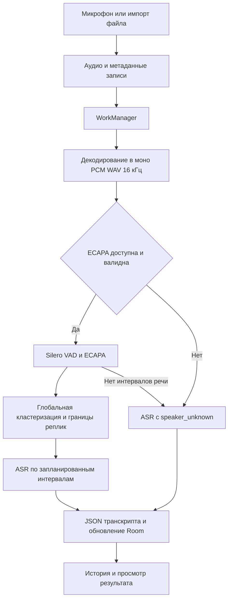

# Архитектура решения

Compose и Navigation Compose показывают запись, историю, настройки и транскрипт. Foreground service управляет микрофоном. Room хранит метаданные записей, DataStore — настройки. Аудио и JSON транскрипта хранятся отдельно. WorkManager запускает обработку в фоне. AudioDecoder преобразует исходный звук во временный PCM WAV, моно, 16 кГц, 16 бит.

| Компонент | Роль и состояние |
| --- | --- |
| Whisper Tiny RU INT8 | Локальный ASR через ONNX Runtime. Log-mel, окна до 30 секунд, жадное декодирование. |
| GigaAM v3 E2E CTC INT8 | Локальный русский ASR. Извлечение признаков и CTC-декодирование. Архив восстанавливается при сборке, проверяется перед установкой. |
| Silero VAD | Определяет интервалы речи. ONNX 16 кГц, opset 15. |
| ECAPA RU | Экспериментальный локальный этап. Граф принимает float `[1, 48000]`, выдаёт эмбеддинг `[1, 1, 192]`. Веса разделены на граф и внешний файл данных. |

С валидной парой ECAPA обработчик выделяет речь, строит голосовые эмбеддинги, группирует окна по всей записи и уточняет границы реплик. `SpeakerAwareAsrCoordinator` запускает ASR на запланированных интервалах. При отсутствии модели или интервалов речи выполняется ASR по записи с меткой `speaker_unknown`. Старый отчёт о диаризации описывает и предыдущие варианты обработки. О текущей последовательности судите по `TranscriptionProcessor`.

Модели устанавливаются из APK в хранилище приложения с проверкой SHA-256. Транскрипция выполняется на устройстве. Разрешения на микрофон и пользовательский выбор файлов относятся к записи и импорту.

## Происхождение моделей

Silero VAD закреплён на конкретном коммите. Тексты MIT для Silero и GigaAM перенесены с исходными файлами. Для точного архива Whisper Tiny RU требуется подтвердить источник русской версии и условия её распространения. Лицензия базовой Whisper сама по себе не устанавливает происхождение этого архива. Для ECAPA не установлены условия распространения весов и обучающих данных. Локальная пара совпадает с SHA-256, закреплёнными в `DiarizationModelFiles`.

- [Лицензия Silero VAD](https://github.com/snakers4/silero-vad/blob/066409f3d9db45a30d21dfcbf9147826ffdd7052/LICENSE)
- [GigaAM](https://github.com/salute-developers/GigaAM)
- [Лицензия базовой Whisper](https://github.com/openai/whisper/blob/main/LICENSE)

В шаблоне также сохранён прежний демонстрационный движок с фиксированным текстом. Фабрика активного ASR его не выбирает.

## Состав репозитория

| Каталог относительно корня | Назначение |
| --- | --- |
| `src/mobile/android/app/src/main/java/com/example/fluffydisco/ui` | Экраны Compose |
| `src/mobile/android/app/src/main/java/com/example/fluffydisco/service` | Запись с foreground service |
| `src/mobile/android/app/src/main/java/com/example/fluffydisco/data/audio` | Запись, импорт, воспроизведение и декодирование |
| `src/mobile/android/app/src/main/java/com/example/fluffydisco/data/transcription` | Фоновая обработка и ASR-движки |
| `src/mobile/android/app/src/main/java/com/example/fluffydisco/data/diarization` | VAD, эмбеддинги, кластеризация, планирование реплик |
| `src/mobile/android/app/src/main/java/com/example/fluffydisco/data/local` | База Room |
| `src/mobile/android/app/src/main/java/com/example/fluffydisco/data/storage` | Аудио, JSON и настройки хранения |
| `src/mobile/android/model-parts` | Части большого архива GigaAM |
| `src/mobile/android/buildSrc` | Задача восстановления модельного архива |
| `src/mobile/android/scripts` и `tests` | Инструменты и Python-тесты архивов |
| `docs` и `artifacts/test-results` | Документация сдачи и журнал проверок |

## Путь данных

`TranscriptionWorker` получает идентификатор записи. Для ошибок ввода-вывода предусмотрено до трёх попыток. После исчерпания попыток или другой ошибки запись получает статус `FAILED`. Отмена корутины передаётся дальше через `CancellationException`.

## Реализация ASR

`TranscriptionEngine` задаёт общий контракт, возвращающий список сегментов. Фабрика выбирает движок по установленной модели. Whisper использует ONNX encoder и decoder, токенизатор и конфигурацию. Его обработка включает log-mel признаки и последовательное жадное декодирование. GigaAM использует `model.int8.onnx`, словарь `tokens.txt`, собственный вычислитель признаков и CTC-декодер.

В каталоге реально зарегистрированы две ASR-модели. Константы `medium` и `ultra_pro_max` не соответствуют отдельным доступным моделям текущего списка. ONNX Runtime Android закреплён на версии 1.23.2 в каталоге зависимостей.

## Диаризация

Silero VAD отделяет речь от неречевых участков. ECAPA преобразует окно из 48 000 отсчётов, то есть 3 секунд при 16 кГц, в 192-мерный вектор голоса. Нормализованные векторы используются для сравнения и глобальной группировки. Идентификаторы спикеров действуют внутри одной записи.

Граф ECAPA занимает 652 140 байт, внешний файл весов — 83 419 892 байта. Они должны находиться рядом. При подготовке проверяются размеры и SHA-256, затем файлы копируются в приватное хранилище приложения. Совпадение SHA-256 подтверждает соответствие ожидаемым файлам.

## Хранение и приватность

Room хранит метаданные и состояние обработки, а JSON содержит `schemaVersion`, `source` и массив `segments`. Каждый сегмент содержит `startMs`, `endMs`, `speakerId`, `text`. Для пользовательской папки используется Storage Access Framework, для стандартного размещения JSON — MediaStore.

В манифесте приложения заявлены разрешения микрофона, foreground service и уведомлений. Разрешение INTERNET в исходном манифесте отсутствует. При этом выбранная пользователем папка может принадлежать облачному провайдеру документов. В манифесте также включено `allowBackup`, поэтому условия системного резервирования следует учитывать отдельно от локальности инференса.
